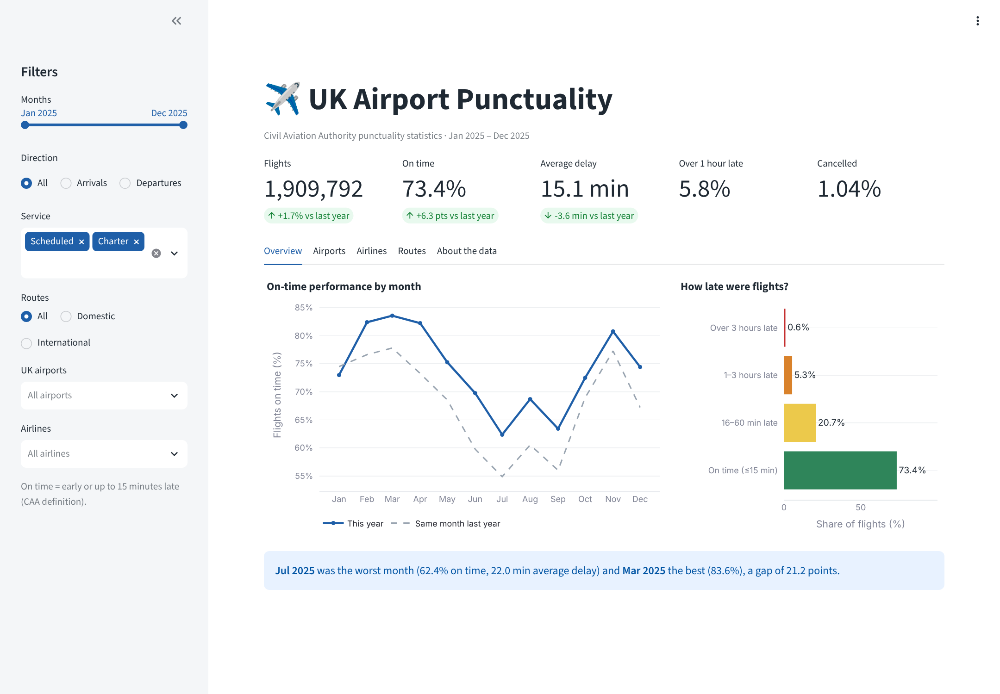
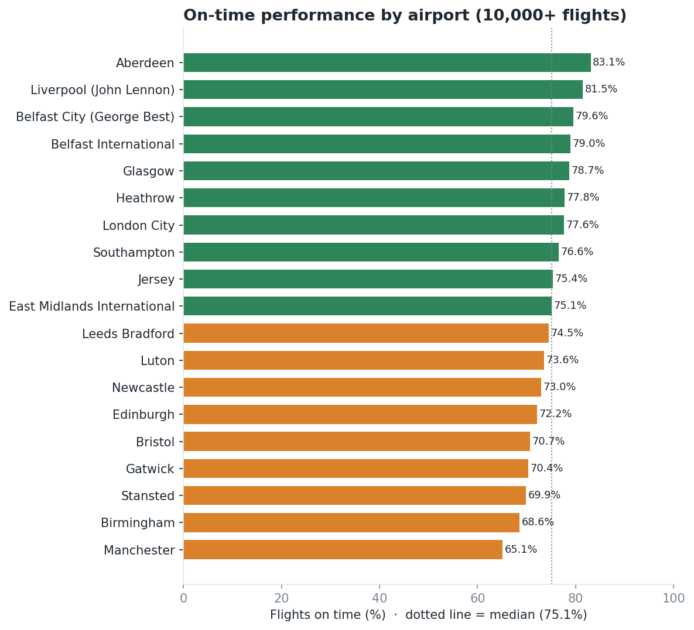
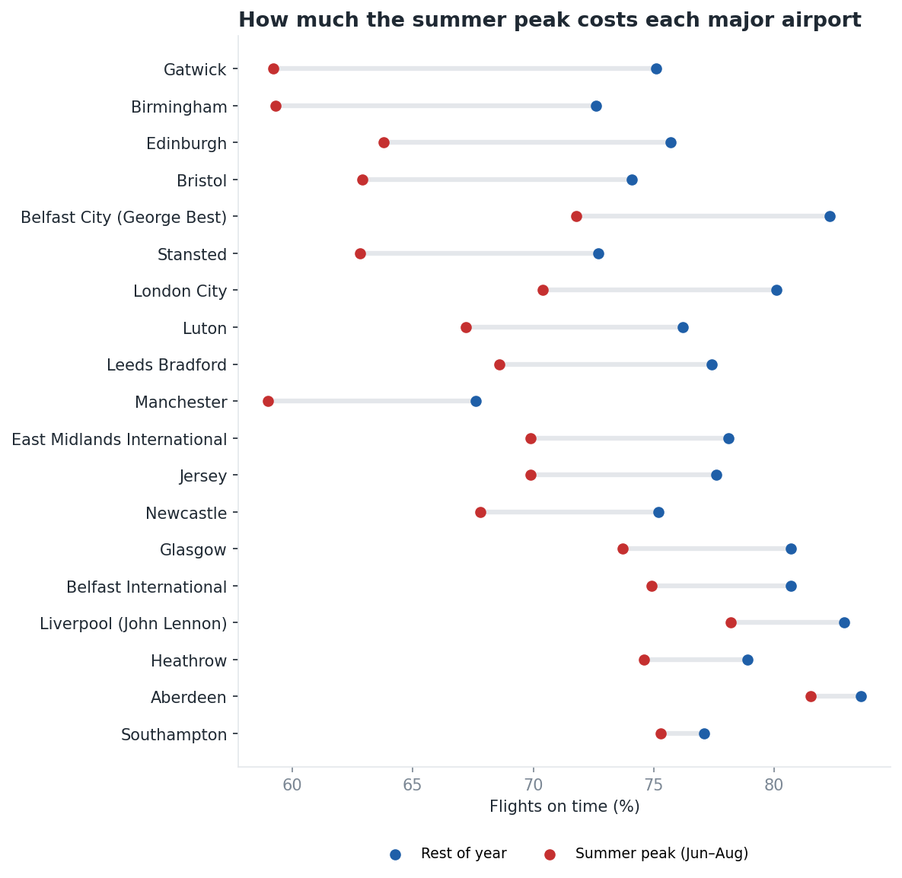
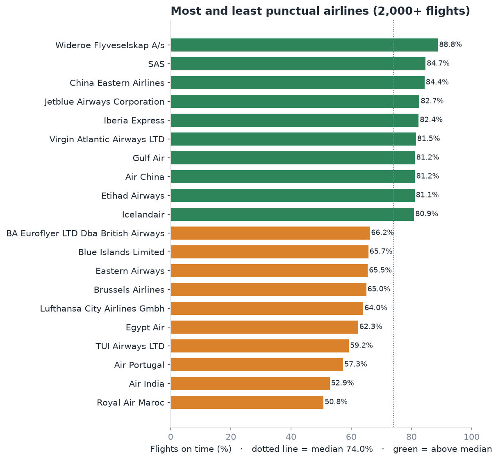
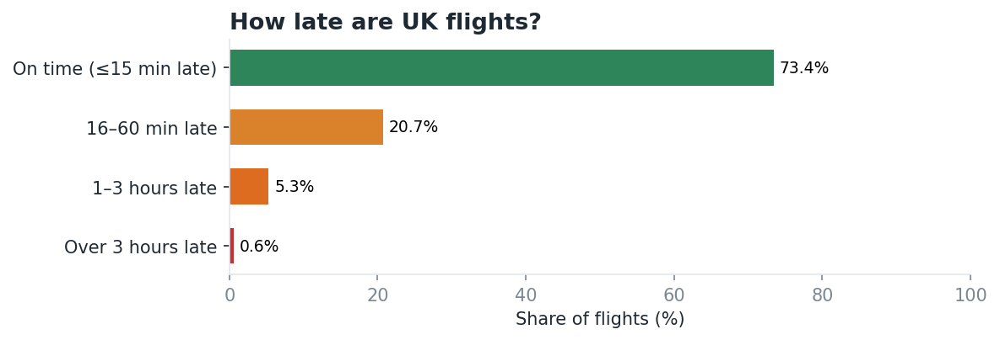
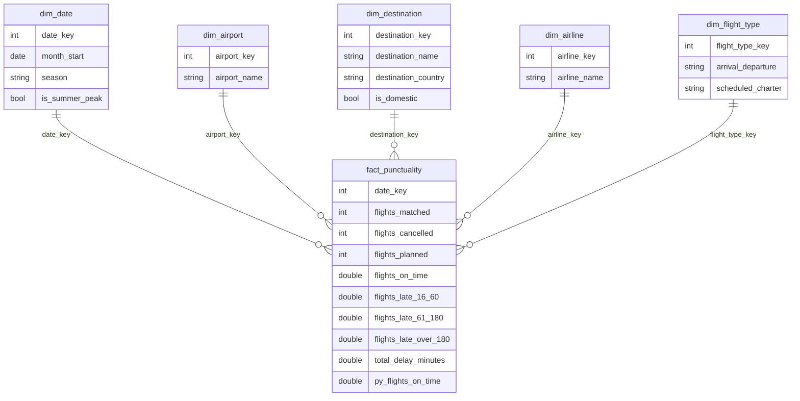
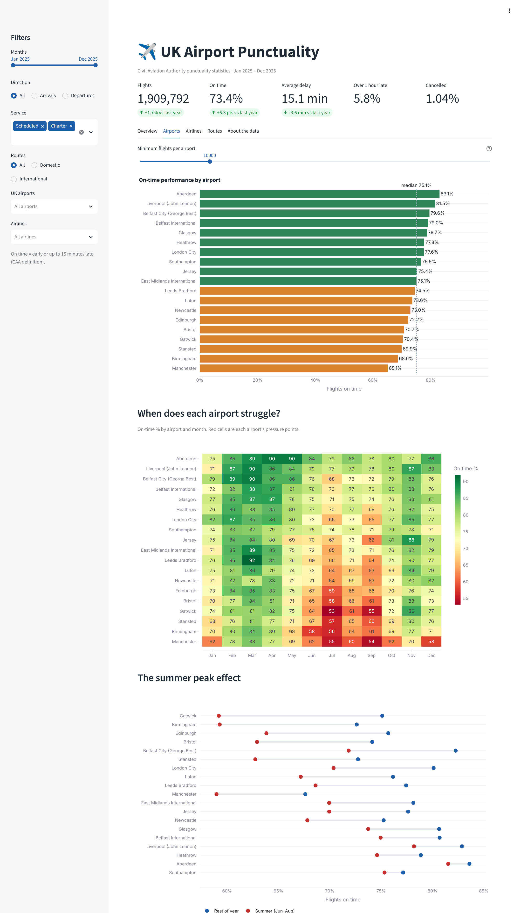
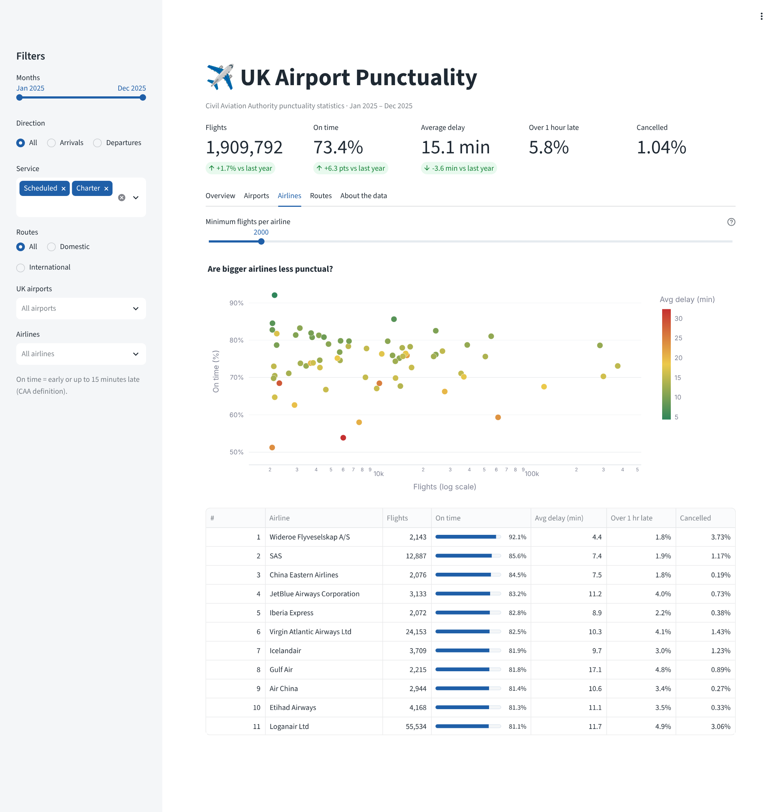
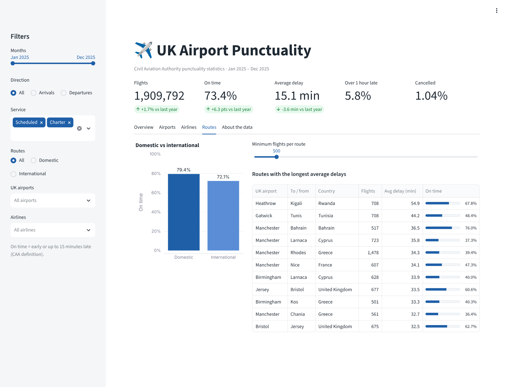
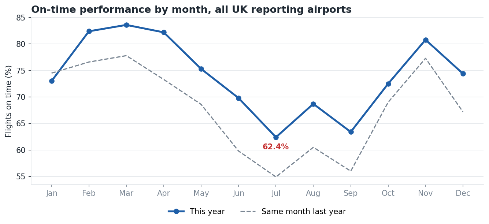

# ✈️ UK Airport Punctuality: SQL Star Schema & Power BI Analytics


An end-to-end analytics project on **official UK Civil Aviation Authority (CAA) punctuality statistics**. A Python pipeline downloads a year of monthly CAA data, validates and reconciles it, and loads it into a **SQL star schema**. SQL answers 13 business questions. An interactive **Streamlit dashboard** lets stakeholders compare airport efficiency, track on-time KPIs and evaluate carrier performance, and the same star schema ships as a **Power BI-ready model with DAX measures**.

> 🔗 **Live dashboard:** https://illiyinsakhawat-db-uk-airport-punctuality-streamlit-app-kauc1n.streamlit.app/



---

## 📌 Business questions

1. How punctual are UK flights overall, and how does that compare with last year?
2. Which **airports** are most and least punctual, and **when** in the year is each one under most pressure?
3. How much does the **summer peak** (June–August) cost each major airport?
4. Which **airlines** are most punctual, and which are most consistent from month to month?
5. Which **routes** have the longest delays? Are domestic or international routes better?

---

## 💡 Key findings (Jan–Dec 2025, 1.9 million flights)

- **73.4% of flights were on time**, up from 67.1% in the same months of 2024. Average delay was 15.1 minutes, and 5.8% of flights were more than an hour late.
- **Summer is the bottleneck.** On-time performance fell from 83.6% in March to **62.4% in July**. The June–August peak cost major airports **8.3 points** on average, and **Gatwick** lost the most (**−15.9 points**).
- **Airports:** **Aberdeen** (83.1%) and **Liverpool** (81.5%) were the most punctual major airports, and **Manchester** the least (65.1%, 19.8 min average delay). **Heathrow** improved most on 2024 (+10.4 points).
- **Domestic routes** ran on time 79.4% of the time, vs 72.1% for international routes. **Charter arrivals** were the least punctual flight type (54.7%).
- **Airlines** (2,000+ flights): on-time rates ranged from 92.1% (Widerøe) to 51.2% (Royal Air Maroc).

Full write-up: [`reports/findings.md`](reports/findings.md), generated from the data on every run. Every query result is in [`reports/tables/`](reports/tables/).

| | |
| --- | --- |
|  |  |
|  |  |

---

## 🗂️ Repository structure

```
uk-airport-punctuality/
├── scripts/
│   └── download_data.py          # fetches 12 monthly CAA files (2025)
├── pipeline/
│   ├── extract.py                # reads and cleans the raw CSVs
│   ├── validate.py               # data quality checks + report
│   ├── warehouse.py              # DuckDB load, reconciliation, Power BI export
│   └── report.py                 # runs the SQL analysis, charts and findings
├── sql/
│   ├── 01_star_schema.sql        # dimensions + fact table
│   ├── 02_views.sql              # reporting views
│   └── 03_analysis_queries.sql   # 13 business questions
├── streamlit_app.py              # interactive dashboard
├── .streamlit/config.toml        # dashboard theme
├── docs/screenshots/             # dashboard screenshots
├── powerbi/
│   ├── data/                     # star schema CSVs (dashboard + Power BI; generated)
│   ├── measures.dax              # DAX measures
│   └── build_guide.md            # model, pages and visuals
├── reports/
│   ├── findings.md               # written insights (generated)
│   ├── data_quality_report.md    # checks + reconciliation (generated)
│   ├── charts/                   # PNG charts (generated)
│   └── tables/                   # every query result as CSV (generated)
├── tests/test_pipeline.py        # pytest suite on synthetic CAA-format data
└── run_pipeline.py               # one command runs everything
```

---

## 🧱 Data model

The CAA publishes one row per **month × UK airport × destination × airline × arrival/departure × scheduled/charter**, with delays given as the **percentage** of flights in each delay band. I modelled it as a star schema:



### Key design decision: percentages become counts

Averaging percentages across rows gives the wrong answer, because a route with 10 flights would count as much as one with 10,000. So the fact table converts each delay-band percentage into a **number of flights** (`percent × matched flights / 100`), and stores `total_delay_minutes` instead of an average. Every KPI is then a ratio of sums (`SUM(on_time) / SUM(flights)`), which stays correct at any level of aggregation in SQL and in Power BI.

---

## ✅ Data quality

Before loading, `pipeline/validate.py` checks:
- reporting periods are valid
- key fields aren't blank
- the arrival/departure and scheduled/charter codes are valid
- there are no negative counts
- the delay bands **sum to 100%** for every row with flights
- the grain is unique

After loading, the pipeline **reconciles** total matched, unmatched and cancelled flights between the raw files and the fact table, and stops if they don't match. Results are in [`reports/data_quality_report.md`](reports/data_quality_report.md).

---

## 🔍 SQL highlights

[`sql/03_analysis_queries.sql`](sql/03_analysis_queries.sql) uses:
- **CTEs** to build monthly and airport-level aggregates step by step
- **Window functions:** `RANK()` for league tables, `LAG()` for month-on-month change, `ROW_NUMBER() OVER (PARTITION BY airport)` to find each airport's worst and best month, and `SUM() OVER ()` for share of total
- **`FILTER (WHERE …)`** for summer vs rest-of-year comparisons in a single pass
- **`UNPIVOT`** for the delay-severity distribution
- **`STDDEV_SAMP`** to score airline consistency
- Minimum-volume thresholds (`HAVING`) so tiny operations don't top the rankings

---

## 📊 Interactive dashboard (Streamlit)

[`streamlit_app.py`](streamlit_app.py) reads the star schema and recalculates every KPI from the underlying counts, so the numbers stay correct for any combination of filters.

- **Filters:** month range, arrivals/departures, scheduled/charter, domestic/international, airports and airlines
- **Overview:** KPI cards with change vs last year, monthly on-time trend vs last year, delay severity
- **Airports:** ranked league table, an **airport × month heatmap** showing when each airport struggles, and the summer-peak effect
- **Airlines:** size vs punctuality scatter, plus a sortable league table
- **Routes:** domestic vs international, and the routes with the longest average delays

| | |
| --- | --- |
|  |  |
|  |  |

---

## 🟨 Power BI model

The same star schema loads straight into Power BI. The model design, relationships and a planned four-page report are documented for building in Power BI Desktop (Windows). Planned pages: **Overview** (KPI cards, monthly trend vs last year, delay severity), **Airports** (league table plus an airport × month heatmap showing peak bottlenecks), **Airlines** (ranking, size vs punctuality scatter, consistency) and **Routes** (worst routes, domestic vs international, drill-through).

- Measures: [`powerbi/measures.dax`](powerbi/measures.dax), including on-time %, average delay, cancellation %, YoY and MoM change, summer effect and ranked league tables.
- Step-by-step build: [`powerbi/build_guide.md`](powerbi/build_guide.md)

<!-- After building the dashboard, add page screenshots to powerbi/screenshots/ and show them here, e.g.
 -->


---

## ▶️ How to run

```bash
python3 -m venv .venv && source .venv/bin/activate
pip install -r requirements.txt

python scripts/download_data.py   # 12 monthly CAA files → data/raw/
python run_pipeline.py            # validate → load → export → analyse
streamlit run streamlit_app.py    # open the dashboard at http://localhost:8501
pytest                            # tests
```

Outputs: `data/warehouse.duckdb` (query it with the DuckDB CLI or Python), `powerbi/data/*.csv`, and everything in `reports/`.

To analyse another year, add that year's file IDs from the CAA page to `scripts/download_data.py`.

### Deploy the dashboard (free)

1. Push this repo to GitHub, including `powerbi/data/` (the dashboard reads those CSVs).
2. Go to [share.streamlit.io](https://share.streamlit.io), sign in with GitHub and choose **Create app**.
3. Pick this repo, branch `main` and main file `streamlit_app.py`, then **Deploy**.
4. Paste the app link at the top of this README.

---

## ⚠️ Limitations

- The CAA data is **monthly and aggregated**. It has no individual flights and no time of day, so "peak" analysis is by month and season.
- It records **how late** flights were, not **why** (air traffic control, weather, airline operations and so on).
- "On time" follows the CAA definition: early, or up to 15 minutes late.
- Airlines appear under their **operating legal entity** (for example easyJet UK Ltd and easyJet Europe are listed separately), exactly as reported to the CAA.
- The CAA's delay-band percentages are shares of **planned** flights (including cancellations), so the pipeline multiplies them by planned flights. The data quality report confirms that the bands, unmatched % and cancelled % add up to 100%.

---

## 📚 Data source

UK Civil Aviation Authority, [Punctuality statistics 2025](https://www.caa.co.uk/data-and-analysis/uk-aviation-market/flight-punctuality/uk-flight-punctuality-statistics/2025/), *Full Analysis Arrival Departure* monthly files. Check the CAA website for the terms of reuse.
